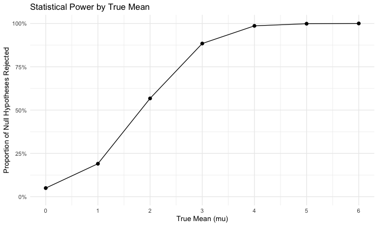
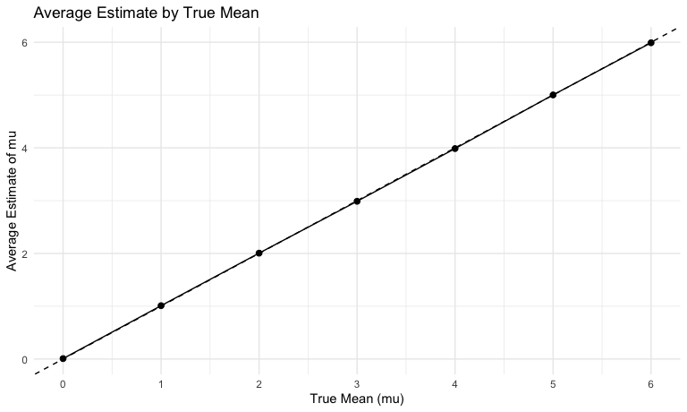
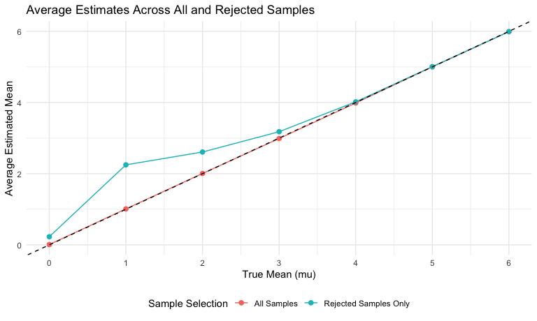

p8105_hw5_yw4657
================

# Problem 1

``` r
birthday_repeated = function(n) {

  birthdays = sample(
    1:365,
    size = n,
    replace = TRUE
  )

  repeated = length(unique(birthdays)) < n

  return(repeated)
}
```

``` r
birthday_results_df =
  expand_grid(
    group_size = 2:50,
    iter = 1:10000
  ) |>
  mutate(
    repeated = map_lgl(group_size, birthday_repeated)
  )

birthday_prob_df =
  birthday_results_df |>
  group_by(group_size) |>
  summarize(
    prob_repeat = mean(repeated),
    .groups = "drop"
  )

birthday_prob_df
```

    ## # A tibble: 49 × 2
    ##    group_size prob_repeat
    ##         <int>       <dbl>
    ##  1          2      0.0019
    ##  2          3      0.0077
    ##  3          4      0.0182
    ##  4          5      0.0256
    ##  5          6      0.0378
    ##  6          7      0.0568
    ##  7          8      0.0752
    ##  8          9      0.0888
    ##  9         10      0.114 
    ## 10         11      0.139 
    ## # ℹ 39 more rows

``` r
birthday_prob_df |>
  ggplot(aes(x = group_size, y = prob_repeat)) +
  geom_point() +
  geom_line() +
  labs(
    title = "Probability of Shared Birthdays by Group Size",
    x = "Group Size",
    y = "Probability of Shared Birthdays"
  ) +
  scale_y_continuous(
    limits = c(0, 1),
    labels = scales::percent
  )
```


The probability that at least two people share a birthday increases as
group size increases. The relationship is nonlinear, with the
probability increasing rapidly for smaller group sizes before gradually
approaching 1. The probability exceeds approximately 50% when the group
contains 23 people. This illustrates the birthday paradox, where shared
birthdays become surprisingly likely even in relatively small groups.

# Problem 2

``` r
file_names =
  tibble(
    file_name = list.files(
      path = "./data",
      pattern = "\\.csv$",
      full.names = TRUE
    )
  )

file_names
```

    ## # A tibble: 20 × 1
    ##    file_name        
    ##    <chr>            
    ##  1 ./data/con_01.csv
    ##  2 ./data/con_02.csv
    ##  3 ./data/con_03.csv
    ##  4 ./data/con_04.csv
    ##  5 ./data/con_05.csv
    ##  6 ./data/con_06.csv
    ##  7 ./data/con_07.csv
    ##  8 ./data/con_08.csv
    ##  9 ./data/con_09.csv
    ## 10 ./data/con_10.csv
    ## 11 ./data/exp_01.csv
    ## 12 ./data/exp_02.csv
    ## 13 ./data/exp_03.csv
    ## 14 ./data/exp_04.csv
    ## 15 ./data/exp_05.csv
    ## 16 ./data/exp_06.csv
    ## 17 ./data/exp_07.csv
    ## 18 ./data/exp_08.csv
    ## 19 ./data/exp_09.csv
    ## 20 ./data/exp_10.csv

``` r
study_df =
  file_names |>
  mutate(
    data = map(file_name, read_csv, show_col_types = FALSE)
  )

study_df
```

    ## # A tibble: 20 × 2
    ##    file_name         data              
    ##    <chr>             <list>            
    ##  1 ./data/con_01.csv <spc_tbl_ [1 × 8]>
    ##  2 ./data/con_02.csv <spc_tbl_ [1 × 8]>
    ##  3 ./data/con_03.csv <spc_tbl_ [1 × 8]>
    ##  4 ./data/con_04.csv <spc_tbl_ [1 × 8]>
    ##  5 ./data/con_05.csv <spc_tbl_ [1 × 8]>
    ##  6 ./data/con_06.csv <spc_tbl_ [1 × 8]>
    ##  7 ./data/con_07.csv <spc_tbl_ [1 × 8]>
    ##  8 ./data/con_08.csv <spc_tbl_ [1 × 8]>
    ##  9 ./data/con_09.csv <spc_tbl_ [1 × 8]>
    ## 10 ./data/con_10.csv <spc_tbl_ [1 × 8]>
    ## 11 ./data/exp_01.csv <spc_tbl_ [1 × 8]>
    ## 12 ./data/exp_02.csv <spc_tbl_ [1 × 8]>
    ## 13 ./data/exp_03.csv <spc_tbl_ [1 × 8]>
    ## 14 ./data/exp_04.csv <spc_tbl_ [1 × 8]>
    ## 15 ./data/exp_05.csv <spc_tbl_ [1 × 8]>
    ## 16 ./data/exp_06.csv <spc_tbl_ [1 × 8]>
    ## 17 ./data/exp_07.csv <spc_tbl_ [1 × 8]>
    ## 18 ./data/exp_08.csv <spc_tbl_ [1 × 8]>
    ## 19 ./data/exp_09.csv <spc_tbl_ [1 × 8]>
    ## 20 ./data/exp_10.csv <spc_tbl_ [1 × 8]>

``` r
study_tidy_df =
  study_df |>
  mutate(
    arm = case_when(
      str_detect(file_name, "con_") ~ "Control",
      str_detect(file_name, "exp_") ~ "Experimental"
    ),
    subject_id = str_extract(
      basename(file_name), "\\d+"
    )
  ) |>
  select(-file_name) |>
  unnest(data) |>
  pivot_longer(
    cols = starts_with("week_"),
    names_to = "week",
    values_to = "observation"
  ) |>
  mutate(
    week = as.numeric(str_remove(week, "week_")),
    arm = factor(
      arm,
      levels = c("Control", "Experimental")
    )
  ) |>
  arrange(arm, subject_id, week)

study_tidy_df
```

    ## # A tibble: 160 × 4
    ##    arm     subject_id  week observation
    ##    <fct>   <chr>      <dbl>       <dbl>
    ##  1 Control 01             1        0.2 
    ##  2 Control 01             2       -1.31
    ##  3 Control 01             3        0.66
    ##  4 Control 01             4        1.96
    ##  5 Control 01             5        0.23
    ##  6 Control 01             6        1.09
    ##  7 Control 01             7        0.05
    ##  8 Control 01             8        1.94
    ##  9 Control 02             1        1.13
    ## 10 Control 02             2       -0.88
    ## # ℹ 150 more rows

``` r
study_tidy_df |>
  ggplot(
    aes(
      x = week,
      y = observation,
      group = interaction(arm, subject_id),
      color = arm
    )
  ) +
  geom_line(alpha = 0.6) +
  geom_point(size = 1.5, alpha = 0.8) +
  facet_grid(. ~ arm) +
  scale_x_continuous(breaks = 1:8) +
  labs(
    title = "Weekly Observations by Treatment Arm",
    x = "Week",
    y = "Observation",
    color = "Treatment Arm"
  )
```


The spaghetti plot shows different longitudinal patterns between the
control and experimental groups. Observations in the control group
remain relatively stable across the eight weeks, with some individual
variability. In contrast, participants in the experimental group
generally show increasing observations over time. Although there is
variation across individuals, the upward trend in the experimental group
suggests a positive effect of the experimental intervention on the
measured outcome. However, since we did not conduct a hypothesis test,
this descriptive comparison alone does not establish statistical
significance.

# Problem 3

``` r
sim_ttest = function(mu, n = 30, sigma = 5) {

  sim_data = tibble(
    x = rnorm(
      n = n,
      mean = mu,
      sd = sigma
    )
  )

  test_results =
    t.test(sim_data$x, mu = 0) |>
    broom::tidy()

  test_results |>
    select(estimate, p.value)
}
```

``` r
sim_results_df =
  expand_grid(
    mu = 0:6,
    iter = 1:5000
  ) |>
  mutate(
    test_results = map(mu, sim_ttest)
  ) |>
  unnest(test_results) |>
  mutate(
    reject = p.value < 0.05
  )

sim_results_df
```

    ## # A tibble: 35,000 × 5
    ##       mu  iter estimate p.value reject
    ##    <int> <int>    <dbl>   <dbl> <lgl> 
    ##  1     0     1   -0.829  0.436  FALSE 
    ##  2     0     2   -0.546  0.610  FALSE 
    ##  3     0     3   -1.33   0.0909 FALSE 
    ##  4     0     4    0.175  0.869  FALSE 
    ##  5     0     5    0.680  0.447  FALSE 
    ##  6     0     6   -0.311  0.758  FALSE 
    ##  7     0     7   -0.876  0.353  FALSE 
    ##  8     0     8    0.278  0.811  FALSE 
    ##  9     0     9    0.366  0.669  FALSE 
    ## 10     0    10    1.11   0.234  FALSE 
    ## # ℹ 34,990 more rows

``` r
power_df =
  sim_results_df |>
  group_by(mu) |>
  summarize(
    power = mean(reject),
    .groups = "drop"
  )

power_df
```

    ## # A tibble: 7 × 2
    ##      mu  power
    ##   <int>  <dbl>
    ## 1     0 0.0498
    ## 2     1 0.190 
    ## 3     2 0.567 
    ## 4     3 0.884 
    ## 5     4 0.986 
    ## 6     5 0.999 
    ## 7     6 1

``` r
power_df |>
  ggplot(aes(x = mu, y = power)) +
  geom_point(size = 2) +
  geom_line() +
  scale_x_continuous(breaks = 0:6) +
  scale_y_continuous(
    limits = c(0, 1),
    labels = scales::percent
  ) +
  labs(
    title = "Statistical Power by True Mean",
    x = "True Mean (mu)",
    y = "Proportion of Null Hypotheses Rejected"
  )
```



The probability of rejecting the null hypothesis increases as the true
mean increases from 0 to 6. When the true mean is 0, the rejection
proportion is approximately 0.05, consistent with the nominal Type I
error rate. As the true mean moves further away from the null value, the
effect size increases relative to the fixed standard deviation, making
it easier to detect a statistically significant difference.
Consequently, statistical power increases and approaches 1 for larger
values of the true mean.

``` r
estimate_df =
  sim_results_df |>
  group_by(mu) |>
  summarize(
    mean_estimate = mean(estimate),
    mean_estimate_rejected =
      mean(estimate[reject]),
    .groups = "drop"
  )

estimate_df
```

    ## # A tibble: 7 × 3
    ##      mu mean_estimate mean_estimate_rejected
    ##   <int>         <dbl>                  <dbl>
    ## 1     0       0.00733                  0.228
    ## 2     1       1.01                     2.25 
    ## 3     2       2.01                     2.61 
    ## 4     3       2.99                     3.18 
    ## 5     4       3.99                     4.02 
    ## 6     5       5.00                     5.01 
    ## 7     6       5.99                     5.99

``` r
estimate_df |>
  ggplot(aes(x = mu, y = mean_estimate)) +
  geom_point(size = 2) +
  geom_line() +
  geom_abline(
    intercept = 0,
    slope = 1,
    linetype = "dashed"
  ) +
  scale_x_continuous(breaks = 0:6) +
  labs(
    title = "Average Estimate by True Mean",
    x = "True Mean (mu)",
    y = "Average Estimate of mu"
  )
```



``` r
estimate_df |>
  pivot_longer(
    cols = c(
      mean_estimate,
      mean_estimate_rejected
    ),
    names_to = "estimate_type",
    values_to = "average_estimate"
  ) |>
  mutate(
    estimate_type = recode(
      estimate_type,
      mean_estimate = "All Samples",
      mean_estimate_rejected = "Rejected Samples Only"
    )
  ) |>
  ggplot(
    aes(
      x = mu,
      y = average_estimate,
      color = estimate_type
    )
  ) +
  geom_point(size = 2) +
  geom_line() +
  geom_abline(
    intercept = 0,
    slope = 1,
    linetype = "dashed"
  ) +
  scale_x_continuous(breaks = 0:6) +
  labs(
    title = "Average Estimates Across All and Rejected Samples",
    x = "True Mean (mu)",
    y = "Average Estimated Mean",
    color = "Sample Selection"
  )
```



The average estimates across all simulated samples are approximately
equal to the true mean, consistent with the unbiasedness of the sample
mean. However, when considering only samples in which the null
hypothesis was rejected, the average estimated mean tends to be larger
than the true mean, particularly for small positive effect sizes. This
difference arises from selection bias. When the true effect is small,
samples with unusually large positive estimates are more likely to
produce statistically significant results. Restricting the analysis to
significant results therefore overrepresents larger estimates and can
exaggerate the magnitude of the true effect. As the true mean increases,
statistical power approaches 1, meaning that nearly all samples reject
the null hypothesis. Consequently, the difference between the average
estimates from all samples and rejected samples becomes smaller. When
the true mean is 0, statistically significant estimates can occur in
both positive and negative directions, so their average may still be
close to 0. Overall, these results illustrate how selecting estimates
based on statistical significance can lead to exaggerated effect sizes,
especially when statistical power is low.
