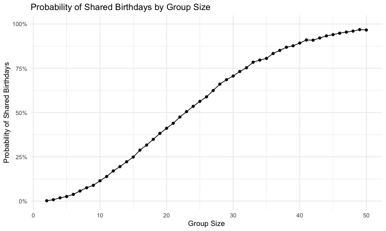
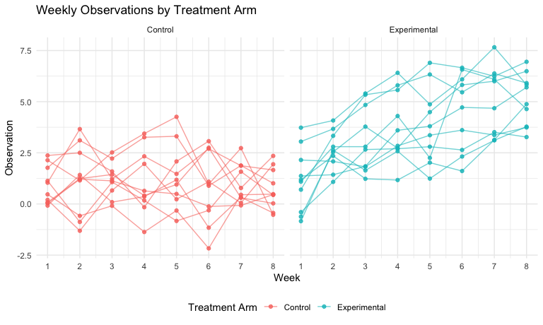

p8105_hw5_yw4657
================

# Problem 1

``` r
birthday_repeated = function(n) {

  birthdays = sample(
    1:365,
    size = n,
    replace = TRUE
  )

  repeated = length(unique(birthdays)) < n

  return(repeated)
}
```

``` r
birthday_results_df =
  expand_grid(
    group_size = 2:50,
    iter = 1:10000
  ) |>
  mutate(
    repeated = map_lgl(group_size, birthday_repeated)
  )

birthday_prob_df =
  birthday_results_df |>
  group_by(group_size) |>
  summarize(
    prob_repeat = mean(repeated),
    .groups = "drop"
  )

birthday_prob_df
```

    ## # A tibble: 49 × 2
    ##    group_size prob_repeat
    ##         <int>       <dbl>
    ##  1          2      0.0019
    ##  2          3      0.0077
    ##  3          4      0.0182
    ##  4          5      0.0256
    ##  5          6      0.0378
    ##  6          7      0.0568
    ##  7          8      0.0752
    ##  8          9      0.0888
    ##  9         10      0.114 
    ## 10         11      0.139 
    ## # ℹ 39 more rows

``` r
birthday_prob_df |>
  ggplot(aes(x = group_size, y = prob_repeat)) +
  geom_point() +
  geom_line() +
  labs(
    title = "Probability of Shared Birthdays by Group Size",
    x = "Group Size",
    y = "Probability of Shared Birthdays"
  ) +
  scale_y_continuous(
    limits = c(0, 1),
    labels = scales::percent
  )
```



The probability that at least two people share a birthday increases as
group size increases. The relationship is nonlinear, with the
probability increasing rapidly for smaller group sizes before gradually
approaching 1. The probability exceeds approximately 50% when the group
contains 23 people. This illustrates the birthday paradox, where shared
birthdays become surprisingly likely even in relatively small groups.

# Problem 2

``` r
file_names =
  tibble(
    file_name = list.files(
      path = "./data",
      pattern = "\\.csv$",
      full.names = TRUE
    )
  )

file_names
```

    ## # A tibble: 20 × 1
    ##    file_name        
    ##    <chr>            
    ##  1 ./data/con_01.csv
    ##  2 ./data/con_02.csv
    ##  3 ./data/con_03.csv
    ##  4 ./data/con_04.csv
    ##  5 ./data/con_05.csv
    ##  6 ./data/con_06.csv
    ##  7 ./data/con_07.csv
    ##  8 ./data/con_08.csv
    ##  9 ./data/con_09.csv
    ## 10 ./data/con_10.csv
    ## 11 ./data/exp_01.csv
    ## 12 ./data/exp_02.csv
    ## 13 ./data/exp_03.csv
    ## 14 ./data/exp_04.csv
    ## 15 ./data/exp_05.csv
    ## 16 ./data/exp_06.csv
    ## 17 ./data/exp_07.csv
    ## 18 ./data/exp_08.csv
    ## 19 ./data/exp_09.csv
    ## 20 ./data/exp_10.csv

``` r
study_df =
  file_names |>
  mutate(
    data = map(file_name, read_csv, show_col_types = FALSE)
  )

study_df
```

    ## # A tibble: 20 × 2
    ##    file_name         data              
    ##    <chr>             <list>            
    ##  1 ./data/con_01.csv <spc_tbl_ [1 × 8]>
    ##  2 ./data/con_02.csv <spc_tbl_ [1 × 8]>
    ##  3 ./data/con_03.csv <spc_tbl_ [1 × 8]>
    ##  4 ./data/con_04.csv <spc_tbl_ [1 × 8]>
    ##  5 ./data/con_05.csv <spc_tbl_ [1 × 8]>
    ##  6 ./data/con_06.csv <spc_tbl_ [1 × 8]>
    ##  7 ./data/con_07.csv <spc_tbl_ [1 × 8]>
    ##  8 ./data/con_08.csv <spc_tbl_ [1 × 8]>
    ##  9 ./data/con_09.csv <spc_tbl_ [1 × 8]>
    ## 10 ./data/con_10.csv <spc_tbl_ [1 × 8]>
    ## 11 ./data/exp_01.csv <spc_tbl_ [1 × 8]>
    ## 12 ./data/exp_02.csv <spc_tbl_ [1 × 8]>
    ## 13 ./data/exp_03.csv <spc_tbl_ [1 × 8]>
    ## 14 ./data/exp_04.csv <spc_tbl_ [1 × 8]>
    ## 15 ./data/exp_05.csv <spc_tbl_ [1 × 8]>
    ## 16 ./data/exp_06.csv <spc_tbl_ [1 × 8]>
    ## 17 ./data/exp_07.csv <spc_tbl_ [1 × 8]>
    ## 18 ./data/exp_08.csv <spc_tbl_ [1 × 8]>
    ## 19 ./data/exp_09.csv <spc_tbl_ [1 × 8]>
    ## 20 ./data/exp_10.csv <spc_tbl_ [1 × 8]>

``` r
study_tidy_df =
  study_df |>
  mutate(
    arm = case_when(
      str_detect(file_name, "con_") ~ "Control",
      str_detect(file_name, "exp_") ~ "Experimental"
    ),
    subject_id = str_extract(
      basename(file_name), "\\d+"
    )
  ) |>
  select(-file_name) |>
  unnest(data) |>
  pivot_longer(
    cols = starts_with("week_"),
    names_to = "week",
    values_to = "observation"
  ) |>
  mutate(
    week = as.numeric(str_remove(week, "week_")),
    arm = factor(
      arm,
      levels = c("Control", "Experimental")
    )
  ) |>
  arrange(arm, subject_id, week)

study_tidy_df
```

    ## # A tibble: 160 × 4
    ##    arm     subject_id  week observation
    ##    <fct>   <chr>      <dbl>       <dbl>
    ##  1 Control 01             1        0.2 
    ##  2 Control 01             2       -1.31
    ##  3 Control 01             3        0.66
    ##  4 Control 01             4        1.96
    ##  5 Control 01             5        0.23
    ##  6 Control 01             6        1.09
    ##  7 Control 01             7        0.05
    ##  8 Control 01             8        1.94
    ##  9 Control 02             1        1.13
    ## 10 Control 02             2       -0.88
    ## # ℹ 150 more rows

``` r
study_tidy_df |>
  ggplot(
    aes(
      x = week,
      y = observation,
      group = interaction(arm, subject_id),
      color = arm
    )
  ) +
  geom_line(alpha = 0.6) +
  geom_point(size = 1.5, alpha = 0.8) +
  facet_grid(. ~ arm) +
  scale_x_continuous(breaks = 1:8) +
  labs(
    title = "Weekly Observations by Treatment Arm",
    x = "Week",
    y = "Observation",
    color = "Treatment Arm"
  )
```



The spaghetti plot shows different longitudinal patterns between the
control and experimental groups. Observations in the control group
remain relatively stable across the eight weeks, with some individual
variability. In contrast, participants in the experimental group
generally show increasing observations over time. Although there is
variation across individuals, the upward trend in the experimental group
suggests a positive effect of the experimental intervention on the
measured outcome. However, since we did not conduct a hypothesis test,
this descriptive comparison alone does not establish statistical
significance.
